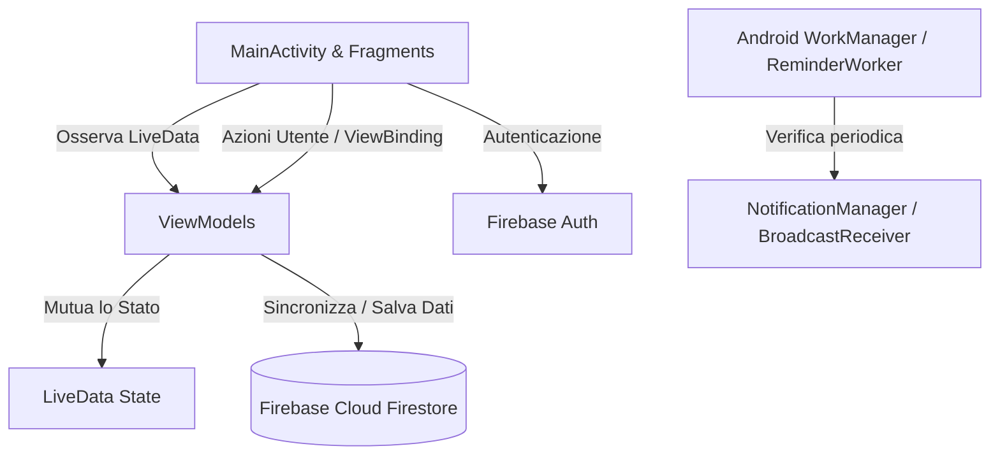

# Finance Flow

[](https://kotlinlang.org)
[](https://developer.android.com/studio/releases/gradle-plugin)
[](https://developer.android.com/about/versions/14)
[](https://developer.android.com)
[](https://firebase.google.com)
[](https://developer.android.com/topic/architecture)

Finance Flow e un'applicazione Android nativa sviluppata in Kotlin per il monitoraggio e la gestione avanzata delle finanze personali. L'applicazione implementa l'architettura MVVM (Model-View-ViewModel), integra la persistenza in cloud in tempo reale con Firebase Firestore, autentica gli utenti tramite Firebase Authentication e fornisce strumenti analitici come grafici a barre interattivi e avvisi automatici sulle soglie di spesa.

---

## Indice

- [Panoramica e Obiettivi](#panoramica-e-obiettivi)
- [Funzionalita Principali](#funzionalita-principali)
- [Architettura dell'Applicazione](#architettura-dellapplicazione)
- [Modello dei Dati e Schema Database](#modello-dei-dati-e-schema-database)
- [Struttura della Repository](#struttura-della-repository)
- [Stack Tecnologico](#stack-tecnologico)
- [Prerequisiti di Sistema](#prerequisiti-di-sistema)
- [Installazione e Configurazione](#installazione-e-configurazione)
- [Strategia di Testing](#strategia-di-testing)
- [Configurazione Build e ProGuard](#configurazione-build-e-proguard)
- [Licenza](#licenza)

---

## Panoramica e Obiettivi

Finance Flow e concepita per offrire agli utenti il pieno controllo sul proprio flusso di cassa giornaliero, mensile e annuale. A differenza dei registri di spesa statici, Finance Flow collega dinamicamente le transazioni registrate con i budget attivi, ricalcolando in tempo reale il saldo residuo e verificando costantemente il rispetto dei limiti prefissati.

I principi guida dello sviluppo includono:
- Separazione delle responsabilita tramite pattern Model-View-ViewModel (MVVM).
- Gestione reattiva dello stato attraverso LiveData e Data Binding / View Binding.
- Sincronizzazione multi-dispositivo in tempo reale supportata da Google Cloud Firestore.
- Esecuzione in background affidabile per la verifica delle scadenze tramite Android WorkManager.

---

## Funzionalita Principali

### 1. Autenticazione e Sicurezza Utente
- Registrazione di nuovi account e autenticazione utenti basata su Firebase Authentication (Email e Password).
- Validazione robusta dei campi del form in fase di inserimento.
- Persistenza della sessione e procedura di logout sicuro con dialogo di conferma.
- Isolamento completo dei dati: ogni utente accede unicamente alla propria sandbox informativa su Firestore.

### 2. Gestione Transazioni e Bilancio (Home)
- Visualizzazione cronologica decrescente di tutte le entrate e le uscite.
- Calcolo automatico e dinamico del saldo totale in valuta EUR.
- Inserimento rapido di transazioni tramite Floating Action Button (FAB) con supporto a importo, tipologia (Entrata o Spesa) e categoria.
- Categorie supportate: Stipendio, Alimentari, Shopping, Spese Mediche, Regali, Bollette, Tutte le Spese.
- Sincronizzazione automatica con i budget: ogni spesa registrata aggiorna istantaneamente l'importo utilizzato (`usedAmount`) nei budget correlati.
- Eliminazione delle transazioni con contestuale ripristino dell'importo nel budget di riferimento.

### 3. Gestione Budget e Analisi Grafica (Dashboard)
- Creazione e pianificazione di budget personalizzati specificando nome, tetto massimo di spesa, valuta, categoria target e frequenza (Settimanale, Mensile, Annuale).
- Calcolo automatico della data di scadenza in base alla frequenza selezionata.
- Monitoraggio della percentuale di completamento del budget (`usedAmount` rispetto ad `amount`).
- Grafico interattivo a barre raggruppate (realizzato con MPAndroidChart) per confrontare entrate e uscite aggregate per ciascuna categoria.
- Eliminazione dei budget tramite interazione prolungata (long click) con finestra di conferma.

### 4. Notifiche, Promemoria e Avvisi Intelligenti (Notifications)
- Doppia sezione operativa: Promemoria programmati e Avvisi di sistema.
- Creazione di promemoria con selettore di data nativo (DatePickerDialog).
- Monitoraggio continuo dei budget attivi: generazione di avvisi immediati in caso di budget superato o scaduto.
- Notifiche push locali ad alta priorita via NotificationChannel Android dedicato (`reminder_channel_id`).
- Background worker basato su WorkManager (`ReminderWorker`), schedulato per un'esecuzione periodica giornaliera, per verificare le scadenze a 2 giorni e odierne.
- BroadcastReceiver (`ReminderNotificationReceiver`) per gestire eventi di notifica di sistema.

---

## Architettura dell'Applicazione

L'applicazione e strutturata secondo i canoni della Single-Activity Architecture supportata da Jetpack Navigation.



### Componenti Architetturali

- **View Layer**: Composto da `LoginActivity`, `MainActivity` e tre fragment principali (`HomeFragment`, `DashboardFragment`, `NotificationsFragment`). Utilizza il ViewBinding per un accesso sicuro ai layout XML.
- **ViewModel Layer**: `HomeViewModel`, `DashboardViewModel` e `NotificationsViewModel` gestiscono la logica di business e mantengono lo stato della UI disaccoppiato dal ciclo di vita di Activity e Fragment.
- **Model Layer**: Data class immutabili e serializzabili (`Expense`, `Budget`, `ReminderItem`, `AlertItem`).
- **Data & Cloud Layer**: Firestore opera sia come archivio persistente sia come bus di eventi in tempo reale tramite snapshot listener.
- **Background Layer**: `ReminderWorker` e `ReminderNotificationReceiver` garantiscono l'esecuzione affidabile dei compiti di monitoraggio anche quando l'applicazione e chiusa.

---

## Modello dei Dati e Schema Database

I dati sono organizzati gerarchicamente su Cloud Firestore all'interno del percorso principale `users/{userId}`.

```
firestore-root/
└── users/
    └── {userId}/
        ├── transactions/
        │   └── {transactionId}/
        │       ├── category: String
        │       ├── amount: Double
        │       ├── isIncome: Boolean
        │       └── date: Timestamp
        ├── budgets/
        │   └── {budgetId}/
        │       ├── name: String
        │       ├── amount: Double
        │       ├── category: String
        │       ├── currency: String
        │       ├── creationDate: Timestamp
        │       ├── expirationDate: Timestamp
        │       └── usedAmount: Double
        └── reminders/
            └── {reminderId}/
                ├── title: String
                └── date: String (dd/MM/yyyy)
```

### Descrizione delle Entita

#### 1. Expense (`com.example.financeflow.ui.home.models.Expense`)
Rappresenta una singola operazione contabile.
- `category` (String): Categoria di appartenenza (es. "Alimentari", "Shopping").
- `amount` (Double): Valore monetario dell'operazione.
- `isIncome` (Boolean): Se impostato a `true` identifica un'entrata, altrimenti un'uscita.
- `date` (Date): Marca temporale dell'operazione.

#### 2. Budget (`com.example.financeflow.ui.dashboard.models.Budget`)
Definisce un piano di spesa con vincoli temporali e massimali.
- `name` (String): Denominazione descrittiva del budget.
- `amount` (Double): Tetto massimo stanziato.
- `category` (String): Categoria applicata ("Tutte le Spese" oppure categoria specifica).
- `currency` (String): Codice valuta (es. "EUR").
- `creationDate` (Date): Data di creazione.
- `expirationDate` (Date): Data di scadenza derivata dalla frequenza selezionata.
- `usedAmount` (Double): Totale speso addebitato a valere su questo budget.

#### 3. ReminderItem (`com.example.financeflow.ui.notifications.models.ReminderItem`)
Promemoria inserito dall'utente per una specifica scadenza.
- `id` (String): Identificativo univoco del documento Firestore.
- `title` (String): Oggetto del promemoria.
- `date` (String): Data programmata formattata in `dd/MM/yyyy`.

#### 4. AlertItem (`com.example.financeflow.ui.notifications.models.AlertItem`)
Avviso di sistema generato localmente o derivato da condizioni di sforamento budget.
- `title` (String): Titolo sintetico dell'avviso.
- `message` (String): Messaggio descrittivo della criticita riscontrata.

---

## Struttura della Repository

```
FinanceFlowKotlin/
├── app/
│   ├── build.gradle.kts                # Configurazione Gradle del modulo app
│   ├── google-services.json            # Configurazione del client Firebase
│   ├── proguard-rules.pro              # Regole di offuscamento e ottimizzazione
│   └── src/
│       ├── androidTest/java/com/example/financeflow/
│       │   ├── DashboardFragmentTest.kt    # Test strumentati per DashboardFragment
│       │   ├── ExampleInstrumentedTest.kt  # Test di contesto Android base
│       │   ├── HomeFragmentTest.kt         # Test strumentati UI per HomeFragment
│       │   └── LoginActivityTest.kt        # Test di interazione su LoginActivity
│       ├── test/java/com/example/financeflow/
│       │   ├── DashboardViewModelTest.kt            # Test unitari con Robolectric per DashboardViewModel
│       │   ├── ExampleUnitTest.kt                   # Test unitari generici
│       │   ├── HomeViewModelTest.kt                 # Test unitari per gestione transazioni e saldi
│       │   └── ReminderNotificationReceiverTest.kt  # Test con shadow notification manager
│       └── main/
│           ├── AndroidManifest.xml     # Dichiarazione componenti, servizi e permessi
│           ├── java/com/example/financeflow/
│           │   ├── LoginActivity.kt    # Schermata di login e registrazione Firebase
│           │   ├── MainActivity.kt     # Host della BottomNavigation e logica di logout
│           │   └── ui/
│           │       ├── home/
│           │       │   ├── HomeFragment.kt          # UI lista movimenti e saldo totale
│           │       │   ├── HomeViewModel.kt         # Logica transazioni e stato reattivo
│           │       │   ├── adapters/
│           │       │   │   └── ExpenseAdapter.kt    # RecyclerView Adapter per le transazioni
│           │       │   └── models/
│           │       │       └── Expense.kt           # Modello dati spesa/entrata
│           │       ├── dashboard/
│           │       │   ├── DashboardFragment.kt     # UI budget e grafico MPAndroidChart
│           │       │   ├── DashboardViewModel.kt    # Calcolo alert di sforamento e scadenze
│           │       │   ├── adapters/
│           │       │   │   └── BudgetAdapter.kt     # RecyclerView Adapter per i budget
│           │       │   └── models/
│           │       │       └── Budget.kt            # Modello dati budget e serializzazione Firestore
│           │       └── notifications/
│           │           ├── NotificationsFragment.kt          # UI unificata promemoria e avvisi
│           │           ├── NotificationsViewModel.kt         # Gestione lista promemoria
│           │           ├── ReminderWorker.kt                 # WorkManager periodic worker
│           │           ├── ReminderNotificationReceiver.kt   # Ricevitore notifiche di broadcast
│           │           ├── adapters/
│           │           │   ├── AlertAdapter.kt               # Adapter per gli avvisi di sistema
│           │           │   └── NotificationAdapter.kt        # Adapter per i promemoria
│           │           └── models/
│           │               ├── AlertItem.kt                  # Modello alert
│           │               └── ReminderItem.kt               # Modello promemoria
│           └── res/
│               ├── layout/             # Layout XML dell'applicazione e dei dialog
│               ├── menu/               # Menu della Bottom Navigation e dell'ActionBar
│               ├── navigation/         # Grafo di navigazione (mobile_navigation.xml)
│               └── values/             # Risorse di testo, colori, dimensioni e temi
├── build.gradle.kts                    # Configurazione root di Gradle e plugin globali
├── gradle.properties                   # Proprieta della JVM e opzioni di compilazione
├── settings.gradle.kts                 # Definizione moduli e repository dei sorgenti
├── gradlew                             # Wrapper Gradle Unix/macOS
└── gradlew.bat                         # Wrapper Gradle Windows
```

---

## Stack Tecnologico

| Componente | Tecnologia / Libreria | Versione | Utilizzo |
| :--- | :--- | :--- | :--- |
| Linguaggio | Kotlin | 1.9.0 | Linguaggio primario di sviluppo |
| Build Tool | Gradle Kotlin DSL | 8.1.3 | Automazione di build, compilazione e test |
| Piattaforma | Android SDK | Compile/Target 34, Min 24 | Target Android 14 con retrocompatibilita ad Android 7.0 |
| Cloud Backend | Firebase BoM | 33.5.0 | Gestione coordinata delle dipendenze Firebase |
| Autenticazione | Firebase Authentication | 22.0.0 | Registrazione e accesso sicuro utenti |
| Database Cloud | Firebase Cloud Firestore | 24.0.0 | Database NoSQL in tempo reale multi-utente |
| UI & Navigation | AndroidX Navigation KTX | 2.8.2 | Navigazione dichiarativa Single-Activity |
| Componenti Grafici | Material Components | 1.12.0 | Pulsanti, dialoghi, text input conformi al Material Design |
| Grafici Analitici | MPAndroidChart | 3.1.0 | Visualizzazione grafica a barre per entrate e spese |
| Background Jobs | AndroidX WorkManager KTX | 2.9.1 | Pianificazione compiti periodici in background |
| Testing Unitario | JUnit 4, Robolectric, Truth | 4.13.2 / 4.10.3 / 1.1.5 | Test su ambiente Android simulato senza emulatore |
| Mocking | Mockito, MockK | 4.8.0 / 1.13.8 | Creazione di mock per ViewModel e LiveData |
| Test Strumentati | Espresso Core / Intents / Contrib | 3.5.1 | Automazione e validazione end-to-end della UI |

---

## Prerequisiti di Sistema

- Android Studio: Versione Hedgehog (2023.1.1) o successiva (raccomandata versione Iguana o Ladybug).
- Java Development Kit (JDK): JDK 17 configurato nelle impostazioni di Android Studio (con compatibilita bytecode Java 8 / JVM 1.8).
- Android SDK: SDK Platform 34 e Build-Tools 34.0.0 installati tramite Android SDK Manager.
- Dispositivo o Emulatore: Dispositivo fisico o Android Virtual Device (AVD) con versione Android 7.0 (API 24) o superiore.

---

## Installazione e Configurazione

### 1. Clonazione del Progetto

```bash
git clone https://github.com/luigiigreco/FinanceFlowKotlin.git
cd FinanceFlowKotlin
```

### 2. Configurazione di Firebase

Il repository include un file di configurazione preimpostato `app/google-services.json` associato a un'istanza di test. Nel caso si desideri collegare la propria istanza Firebase:

1. Accedere alla [Firebase Console](https://console.firebase.google.com/).
2. Creare un nuovo progetto Firebase o selezionarne uno esistente.
3. Aggiungere un'applicazione Android indicando come Package Name:
   ```
   com.example.financeflow
   ```
4. Scaricare il file `google-services.json` generato e posizionarlo nella cartella `app/` del progetto, sovrascrivendo l'esistente.
5. Nella console Firebase, abilitare il provider di autenticazione:
   - Sezione **Authentication** > scheda **Sign-in method** > abilitare **Email/Password**.
6. Creare il database Cloud Firestore:
   - Sezione **Firestore Database** > fare clic su **Crea database** in modalita test o applicando le regole di sicurezza appropriate.

### Esempio Regole di Sicurezza Firestore Consigliate

```javascript
rules_version = '2';
service cloud.firestore {
  match /databases/{database}/documents {
    match /users/{userId}/{document=**} {
      allow read, write: if request.auth != null && request.auth.uid == userId;
    }
  }
}
```

### 3. Compilazione da Riga di Comando

Per compilare l'applicazione generando l'APK di Debug:

```bash
# Su macOS / Linux
./gradlew assembleDebug

# Su Windows
gradlew.bat assembleDebug
```

L'artefatto compilato sara generato nel percorso:
`app/build/outputs/apk/debug/app-debug.apk`

---

## Strategia di Testing

La base di codice e provvista di una suite di test multilivello comprendente test unitari locali e test strumentati per l'interfaccia utente.

### 1. Test Unitari (Unit Testing)

I test unitari non richiedono un dispositivo fisico o un emulatore e sfruttano **Robolectric** per simulare l'ambiente runtime Android a livello SDK 28:
- `HomeViewModelTest`: Verifica l'aggiunta, l'eliminazione e il rimpiazzo della lista di transazioni, monitorando le emissioni dei `LiveData`.
- `DashboardViewModelTest`: Controlla l'aggiunta e la rimozione dei budget, l'aggiornamento dell'ammontare speso e la generazione automatica di stringhe di avviso per budget scaduti o ecceduti.
- `ReminderNotificationReceiverTest`: Utilizza le Shadow Class di Robolectric (`Shadows.shadowOf(NotificationManager)`) per accertare che i canali e le notifiche vengano costruiti con i titoli e i messaggi attesi.

Per eseguire i test unitari:

```bash
./gradlew testDebugUnitTest
```

I report HTML dettagliati saranno disponibili in:
`app/build/reports/tests/testDebugUnitTest/index.html`

### 2. Test Strumentati (UI & Integration Testing)

I test strumentati convalidano il comportamento dell'interfaccia utente mediante **Espresso**:
- `LoginActivityTest`: Simula l'inserimento di credenziali nei campi di testo e l'interazione con il pulsante di accesso.
- `HomeFragmentTest`: Esegue l'apertura del dialogo di aggiunta transazione, la compilazione dei campi e la selezione delle categorie dallo Spinner, verificando l'aggiornamento della `RecyclerView` e del campo Saldo Totale.
- `DashboardFragmentTest`: Verifica l'apertura della schermata tramite BottomNavigation, la visualizzazione della lista e il flusso completo di inserimento di un nuovo budget.

Per eseguire i test strumentati (richiede emulatore avviato o dispositivo collegato via ADB):

```bash
./gradlew connectedDebugAndroidTest
```

I risultati saranno consultabili all'indirizzo:
`app/build/reports/androidTests/connected/index.html`

---

## Configurazione Build e ProGuard

Il file `app/proguard-rules.pro` include le regole per preservare i modelli dati e le librerie terze da potenziali problemi di riflessione durante la fase di minificazione:

```proguard
# MPAndroidChart
-keep class com.github.mikephil.charting.** { *; }

# Firebase Firestore Models (preserva costruttori vuoti e getter/setter)
-keepattributes Signature
-keepclassmembers class com.example.financeflow.ui.dashboard.models.** { *; }
-keepclassmembers class com.example.financeflow.ui.home.models.** { *; }
-keepclassmembers class com.example.financeflow.ui.notifications.models.** { *; }
```

---

## Licenza

Questo progetto e rilasciato sotto licenza MIT. Per maggiori dettagli, consultare i termini standard della licenza.
